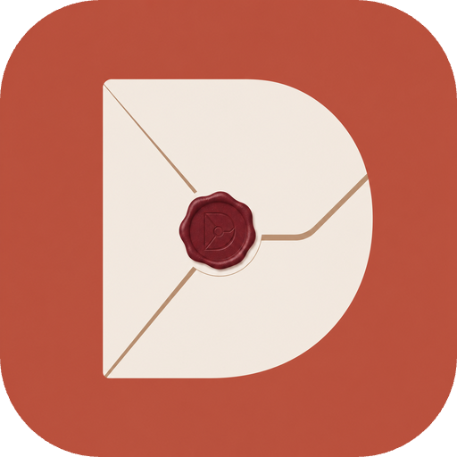
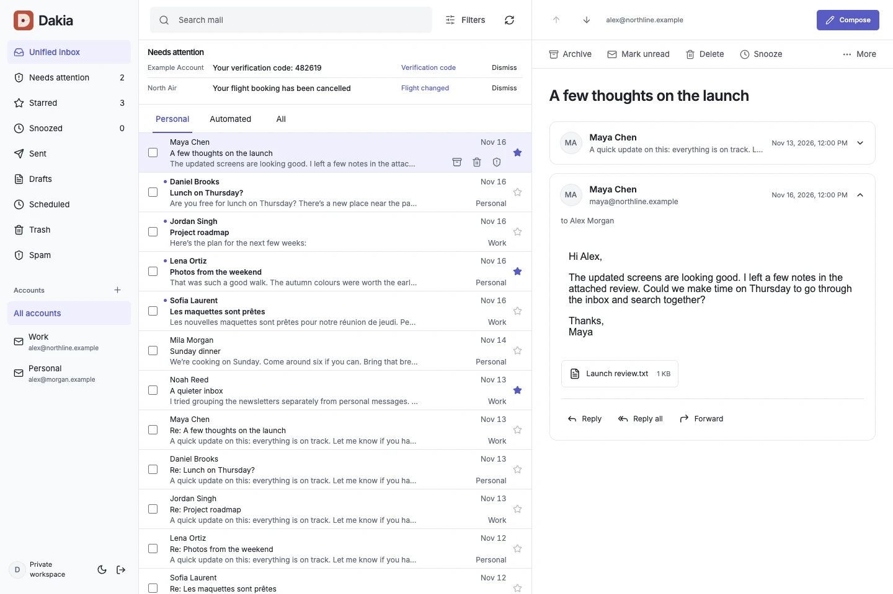
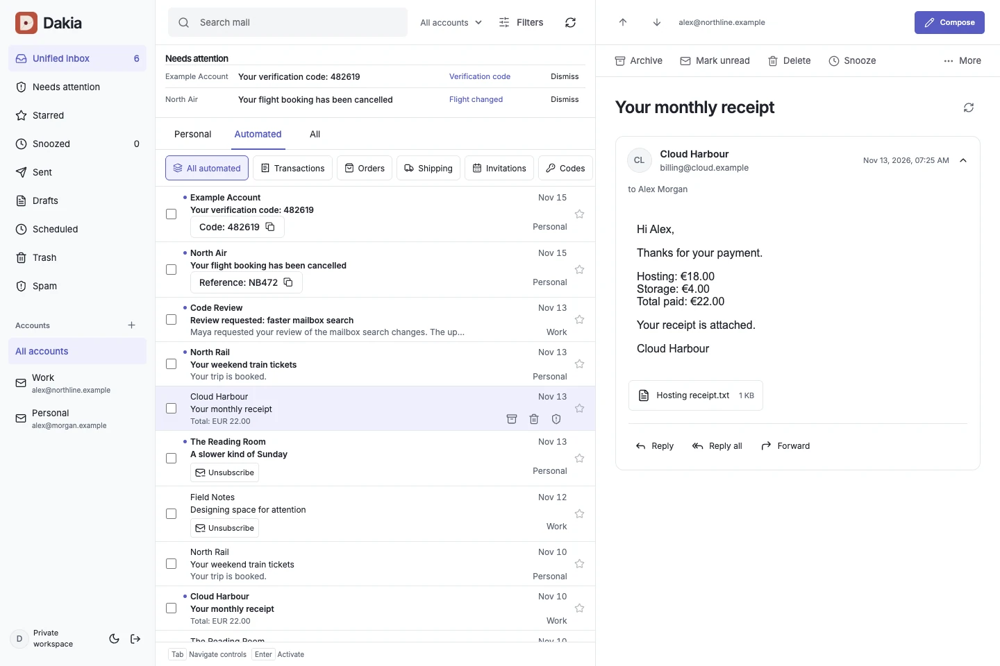
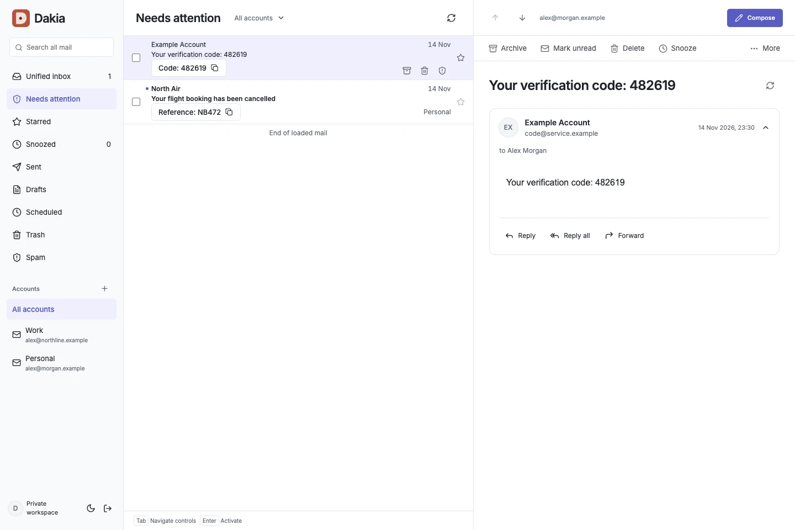
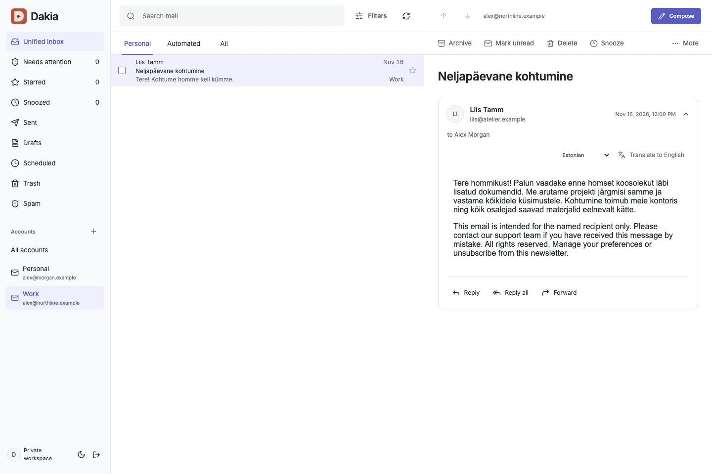
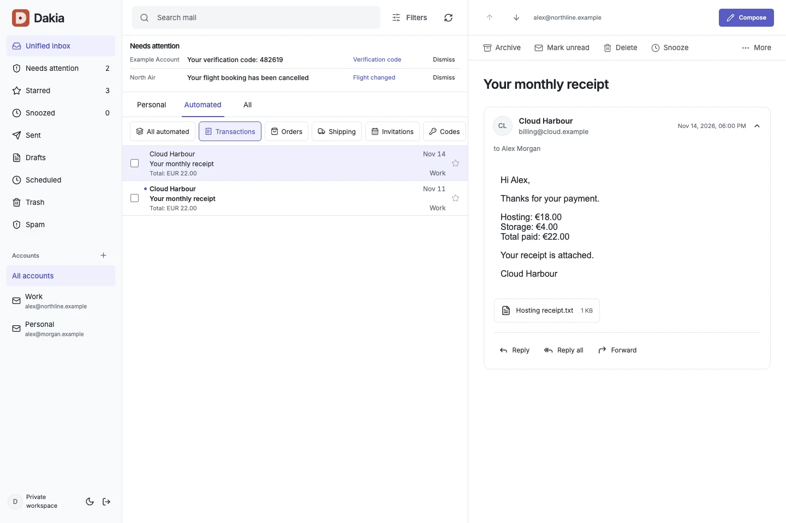
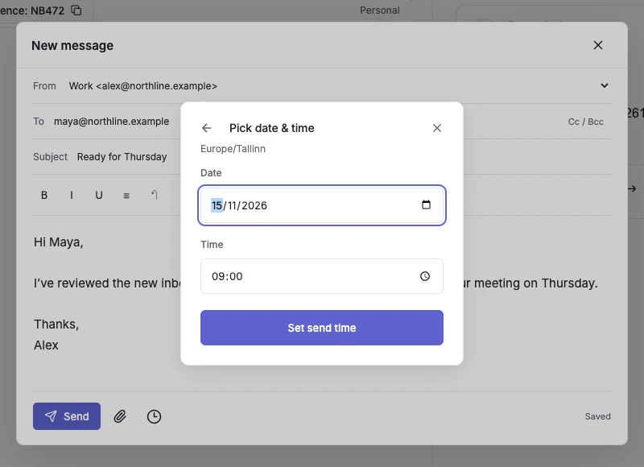
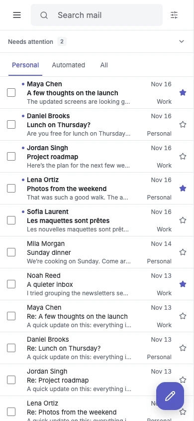
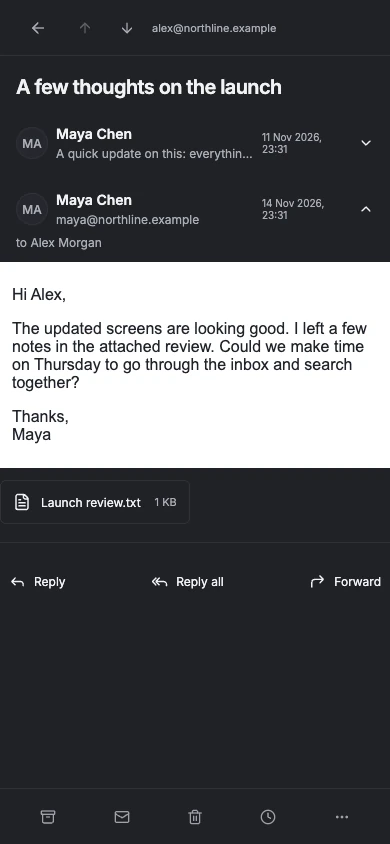

<p align="center"></p>
<h1 align="center">Dakia</h1>
<p align="center">Web-based email client with unified inbox</p>
<p align="center"><a href="https://demo.dakiamail.com">Try the demo</a> · <a href="docs/hosting.md">Self-host Dakia</a> · <a href="docs/features.md">Explore the features</a></p>

Dakia is a free, open-source email client you run on your own server. Bring your existing mailboxes together, keep personal conversations in focus, and translate emails on your device.



## An inbox that starts with people

**Personal** keeps correspondence together. **Automated** gives receipts, newsletters, notifications, and other generated mail their own space. **All** shows everything together. Reading a message doesn't move it out of its tab.

Within Automated, narrow the list to **Transactions**, **Orders**, **Shipping**, **Invitations**, **Codes**, **Flights**, **Newsletters**, **Offers**, or **Security alerts**. Transactions brings receipts and invoices together. A message can belong to more than one filter.



If Dakia gets something wrong, correct the message or remember a sender's preference for that mailbox. Uncertain mail stays in Personal so it remains easy to find.

## Important mail still gets through

Verification codes, flight changes, and other mail that needs attention appear above the inbox tabs and in **Needs attention**. Copy a detected code straight from the list. Reading doesn't dismiss an attention item; dismiss it when you're done, or snooze it for later.



## Translate on your device

Read an email in another language and choose **Translate to English**. With on-device translation enabled, the translation runs in your browser without sending the text to a translation service. Download a language pack once, reuse it for later messages, and switch back to the original whenever you want.

<table>
  <tr>
    <td width="50%"></td>
    <td width="50%"></td>
  </tr>
  <tr>
    <td>The original email.</td>
    <td>English, translated on your device.</td>
  </tr>
</table>

The installation owner chooses on-device translation, on-device with server fallback, or server translation in **Workspace → Translation**. Server translation is the default. [Translation settings and saved languages](docs/on-device-translation.md).

## The rest of your mail, too

Bring Gmail, Outlook.com, Microsoft 365, and other IMAP/SMTP mailboxes into one inbox. Search across your accounts, follow conversations, reply with attachments, or save a draft for later.

<table>
  <tr>
    <td width="50%"></td>
    <td width="50%"></td>
  </tr>
  <tr>
    <td>Find receipts and invoices together.</td>
    <td>Write now and choose when to send.</td>
  </tr>
</table>

Archive, star, snooze, move, or clean up mail in bulk. Unsubscribe from supported mailing lists and block unwanted senders. Keyboard shortcuts and optional shortcut hints keep everyday actions close at hand. Enable “Show extra keyboard hints” in Workspace to show hints beside actions and in the bottom bar. Press `/` to focus mail search, use arrow keys to choose a quick match, or press Enter to search all mail in the selected accounts. Escape closes suggestions without clearing the query. The Filters control adds sender, recipient, subject, folder, date, and read or starred status filters.

## At your desk or on your phone

Use the responsive web app or install it as a PWA. Sign in with the same Dakia login to use your mailboxes on another device. Recent mail is saved in your browser for faster reopening.

<p align="center">
  
  &nbsp;&nbsp;
  
</p>

Invite others to your installation with single-use links. Each person gets their own login, mailbox connections, search, and drafts. [Features and everyday use](docs/features.md).

All screenshots show the running app with fictional mail. [Capture details](docs/images/README.md).

## Get started

Dakia connects to your email provider. You don't need to run a mail server or change MX records.

Dakia is under active development. Back up your installation and try a disposable mailbox before relying on it for important mail.

Use a [prebuilt Linux runtime](docs/native-hosting.md) on AMD64 or ARM64 to run Dakia without Docker or a Rust compiler. Node, workers, and search models are included.

Or follow the [hosting guide](docs/hosting.md) to install Docker through its official packages, review the Compose files, and start the pinned image. The recommended setup doesn't run a Dakia installer as root. Choose public HTTPS with Caddy, your existing proxy, or private Tailscale access.

Restrict access before the first start, then create the owner login before opening the installation to others.

Open your HTTPS address and choose **Sign in**. Create your username and a password with at least 12 characters, then connect a mailbox. The first login owns the installation, so create it before sharing the address. Your Dakia password is separate from your email provider's password.

Gmail and Microsoft sign-in require the operator to register an application with the provider. Gmail app passwords and other IMAP/SMTP connections are also supported. Follow [getting started](docs/getting-started.md) for connection and invitation steps.

## Updates and documentation

Keep both persistent volumes, including the credential encryption key, and take regular backups. The upgrade guide covers reviewed image changes and an optional backup-and-upgrade helper. [Upgrade and recovery guide](docs/upgrading.md).

| Guide | What you'll find |
| --- | --- |
| [Getting started](docs/getting-started.md) | First login, mailbox connection, invitations, and everyday use |
| [Features](docs/features.md) | Inbox filters, translation, search, sending, and cleanup |
| [Gmail](docs/gmail-oauth.md) / [Microsoft](docs/microsoft-oauth.md) | Provider sign-in setup and reconnection |
| [Hosting](docs/hosting.md) / [Operations](deploy/README.md) | Installation, configuration, backups, and recovery |
| [Privacy](docs/privacy.md) / [Security](docs/security.md) | Where mail is processed and how to protect it |
| [Translation](docs/on-device-translation.md) | Translation location and saved language packs |
| [Browser cache](docs/persistent-local-cache.md) | Saved mail, retention, and offline limits |
| [Demo](docs/demo.md) | Run the fictional mailbox locally |

## Development

Use the Rust version in `rust-toolchain.toml`, Node.js 24, npm, Python 3, and OpenSSL development libraries.

```sh
npm ci --ignore-scripts
npm ci --prefix workers/translation --ignore-scripts
npm ci --prefix workers/push --ignore-scripts
npm run build
npm test
cargo test --workspace --locked
```

To build your own container image, run `docker build -t dakia:local .` and set `DAKIA_IMAGE=dakia:local`.

Classification uses local rules and needs no model download. Translation language packs are downloaded and verified when needed. See the [classification reference](docs/personal-first-classification.md) for detection and correction behavior.

Contributions are welcome through pull requests. Keep changes focused and include relevant checks. Never include mailbox data, credentials, or private captures in an issue or pull request.

## License

Dakia is licensed under [MPL 2.0](LICENSE). Dependencies and model artifacts retain their own licenses. See [third-party notices](THIRD_PARTY_NOTICES.md).
