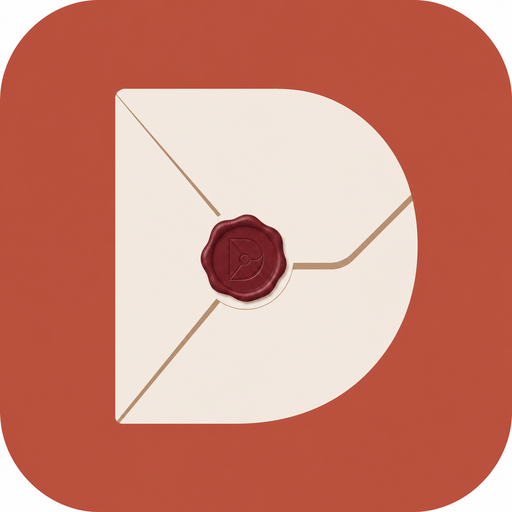
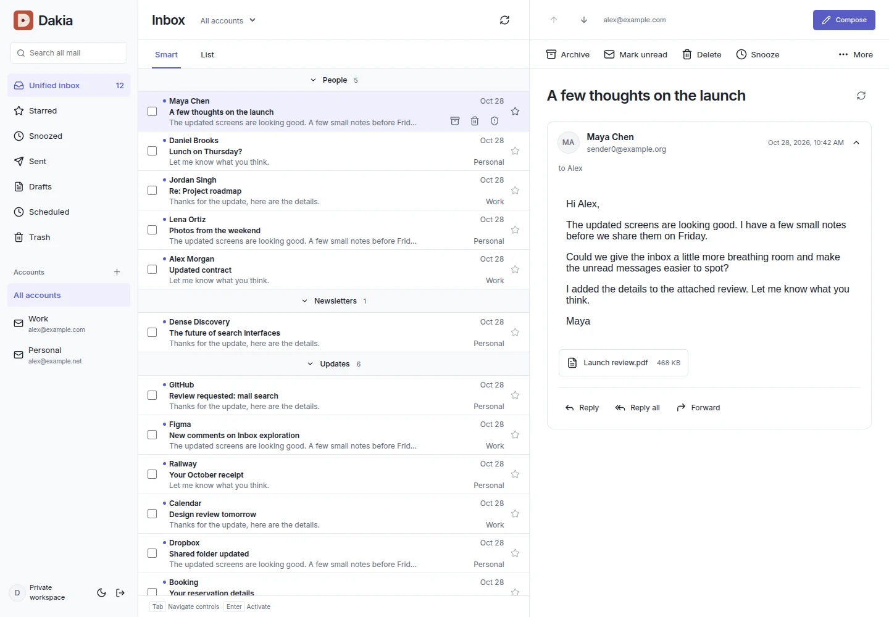
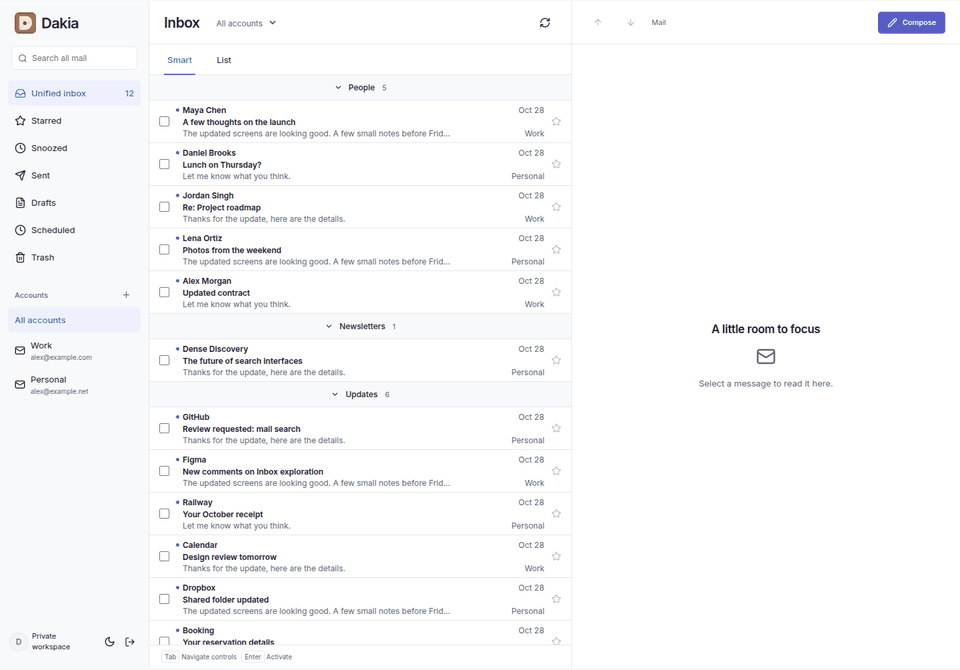

<p align="center"></p>
<h1 align="center">Dakia</h1>
<p align="center">Your mail, on your own server.</p>

Dakia is a free, open-source, self-hosted email client, not a mail server. Keep your existing email providers and bring your IMAP/SMTP mailboxes together on desktop and mobile.



- Bring multiple mailboxes into one inbox without moving your email to a new provider.
- Read conversations, organize with smart categories, and classify or translate mail on your own server.
- Use the same responsive app in your desktop browser or on your phone, with PWA installation available.

[Website](https://dakiamail.com) · [Features](docs/features.md) · [Setup guide](docs/getting-started.md)

## Get started

Dakia is under active development. Back up your installation and try a disposable mailbox before relying on it for important mail.

You need Docker Compose and an HTTPS address through your reverse proxy or Tailscale Serve.

```sh
git clone https://github.com/DakiaMail/dakia-web.git
cd dakia-web
cp .env.example .env
# Set DAKIA_ORIGIN to your HTTPS address, without a trailing slash.
docker compose up -d
```

Open your HTTPS address and choose **Sign in**. Read your private setup code from the host:

```sh
docker compose exec dakia cat /secrets/setup-token
```

Create your username and a password with at least 12 characters, then connect your first mailbox. Your Dakia password is separate from your email provider’s password.

For Gmail, choose **Continue with Google** when Google sign-in is configured for your installation. Each operator supplies their own Google OAuth client. Dakia keeps the refresh token encrypted on your server and renews access automatically. App passwords remain available.

Follow the [Gmail setup guide](docs/gmail-oauth.md) to register your client and configure its ID and secret. The pinned image includes Gmail sign-in. For development, use a separate Google Cloud project and Dakia data directory.

To add another person, open **Workspace → Invite someone → Create invitation** and share the link privately. They choose their own login and connect their own mailboxes. Links expire after 24 hours and work once.

[Follow the setup, invitation, and sign-in guide](docs/getting-started.md). Keep both persistent volumes: losing the credential key means losing access to stored credentials.

Compose pulls a verified preview image for Linux AMD64 or ARM64. It is pinned by digest so an upstream rebuild cannot silently change your installation. Platform-specific NAS and Proxmox walkthroughs are still being validated.

## Keep Dakia updated

Run `sh scripts/upgrade.sh` from your installation directory. It checks published releases, makes a backup, and verifies the upgraded server. Use `--check` to review a release first. The local owner also sees a quiet notice when a release is available. [Upgrade and recovery guide](docs/upgrading.md).

## A quick look



Four views of the running web frontend with fictional mail. Mobile scenes are browser viewports, not native phone captures. [View the static desktop screenshot](docs/images/inbox-desktop.webp) or [the static mobile screenshot](docs/images/inbox-mobile.webp). [Capture details](docs/images/README.md).

## What you can do

- Invite other people to create separate logins and private mailbox connections.
- Connect Gmail with Google sign-in, or other IMAP/SMTP accounts, and use a unified inbox.
- Read conversations, search mail, and organize messages with smart categories.
- Compose rich-text messages with attachments, drafts, and scheduled sending.
- Archive, snooze, star, move, and clean up messages in bulk.
- Block unwanted senders across your mailboxes, with optional cleanup of older emails.
- Classify mail on your server and translate on your device or server.
- Use the responsive web app or install it as a PWA.

[Features and screenshots](docs/features.md)

## Block unwanted senders

Open an email and choose **More actions → Block sender** in the toolbar. Future emails from that exact address move to Trash across your mailboxes without notifications while Dakia syncs. Blocking does not reject delivery at your email provider.

Choose **Review older emails** to find previous messages across your mailboxes, review each mailbox’s results, and confirm the move to Trash. Search can be incomplete; Dakia shows the emails it found and reports pending or failed moves.

Manage blocks in **Workspace → Blocked senders**. Unblocking lets future emails arrive normally and leaves existing Trash untouched. You can restore individual emails from Trash without Dakia moving them back automatically. Mailboxes connected later inherit your blocks; their older mail is left in place.

## Documentation

- [Getting started](docs/getting-started.md): owner setup, joining by invitation, connecting mail, and signing in.
- [Gmail sign-in](docs/gmail-oauth.md): operator-owned Google credentials, connection, reconnection, and development testing.
- [Hosting and deployment](docs/hosting.md): Docker, Proxmox, Mac mini, Synology, TrueNAS, Unraid, and Portainer.
- [Security](docs/security.md): login, encryption, isolation, backups, and reporting vulnerabilities.
- [Privacy](docs/privacy.md): where mail is processed and which services Dakia contacts.
- [Operations](deploy/README.md): existing OIDC installations, configuration, and backup commands.

If Dakia looks useful, [give the repository a star](https://github.com/DakiaMail/dakia-web) to help others find it.

## Development

Use the Rust version in `rust-toolchain.toml`, Node.js 24, npm, Python 3, and OpenSSL development libraries.

```sh
npm ci --ignore-scripts
npm ci --prefix workers/translation --ignore-scripts
npm ci --prefix workers/push --ignore-scripts
python3 scripts/fetch-classifier.py
npm run build
npm test
cargo test --workspace --locked
```

To build your own container image, run `docker build -t dakia:local .` and set `DAKIA_IMAGE=dakia:local`.

The classifier is downloaded from a pinned revision and checked against its SHA-256 manifest. Translation models are downloaded and verified when needed.

Contributions are welcome through pull requests. Keep changes focused and include relevant checks. Never include mailbox data, credentials, or private captures in an issue or pull request.

## Keyboard controls

Use Tab and Shift+Tab to move between controls and composer fields, and Enter or Space to activate buttons. Mail shortcuts work outside text inputs, editors, dialogs, popovers and text selections. Browser/OS chords and IME input keep their normal behavior.

Use J/K for next/previous email, C to compose, / to search, R to reply, Shift+R to reply all, F to forward, E to archive, Delete to move to trash, U to mark unread, Shift+U to mark read, S to toggle stars, X to toggle selection, M to move, B to snooze, and ! to mark spam. Actions apply to checked messages first, then the focused row or open email. Reply and forward load the target email’s content when needed. Navigation follows visible mail order and stops at the first/last loaded email. Press ? for the full shortcut reference. Workspace settings can disable mail shortcuts or enable extra hints beside buttons and in the inbox footer. Preferences are saved per signed-in user on this browser.

Within the Inbox view tablist, unmodified Left/Right and Home/End select tabs. On message checkboxes, Space toggles selection and Shift+Space selects a range; Shift+Enter or Shift+Space on a message button extends the range without opening it. Recipient suggestions support unmodified Up/Down, Enter and Escape. Escape outside editors, text selections and dialogs clears the mail selection/reader; dialogs and the refresh tooltip handle their own Escape. OS modifier chords and IME composition are not consumed by these application handlers. The rich-text editor retains its own standard editing behavior.


## License

Dakia is licensed under [MPL 2.0](LICENSE). Dependencies and model artifacts retain their own licenses. See [third-party notices](THIRD_PARTY_NOTICES.md).

Recent mail is saved in a bounded, user-scoped browser cache for faster reopening
and folder switching. Cached views appear after a fresh session and account check
then refresh in the background. All messages intersecting the mail-list viewport
are prefetched serially without marking them read or loading external images.
Signing out or removing an account clears saved mail in this browser and other
updated tabs. See [persistent local caching](docs/persistent-local-cache.md) for
limits, authorization, retention and offline behavior.

## Try Dakia

Explore the app at [demo.dakiamail.com](https://demo.dakiamail.com). For the sandbox build, checks, and deployment, see [the demo guide](docs/demo.md).

Translation can run on the host or on devices, with an administrator-controlled host fallback option. Choose the policy in Workspace → Translation. [Language packs, administration and verification](docs/on-device-translation.md).

## UI component library

Reusable buttons and the central Mantine theme live in [`@dakia/ui`](packages/ui/README.md). New component migrations should use this package. The development gallery is available at `/ui-gallery.html` while the web dev server is running.
