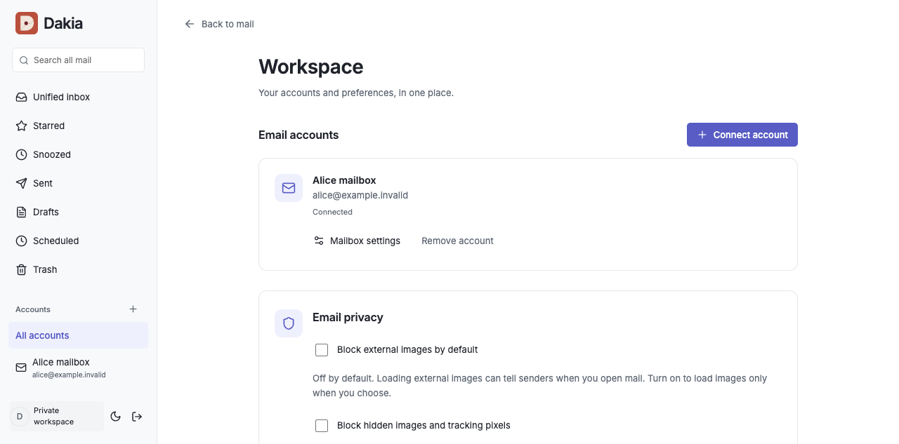
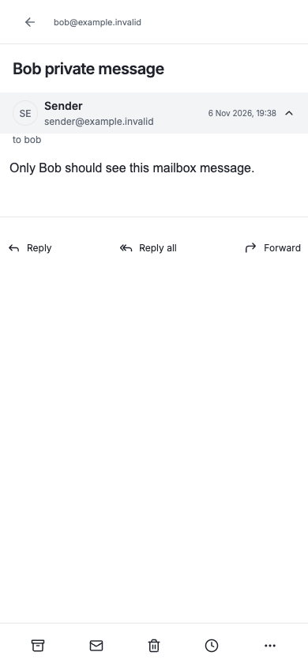

# Features

Dakia connects to existing IMAP/SMTP mailboxes. It does not replace your email provider. See [getting started](getting-started.md) for owner setup, joining, and connecting mail.

## Separate people and mailboxes

The local owner can invite other people with single-use links. Each person chooses their own login and connects their own email accounts. Their unified inbox, search, drafts, and attachments stay scoped to their account. Invitation management does not grant access to someone else's mail.

Each person can connect more than one mailbox. Use the account list for one mailbox or Unified inbox for all of your own accounts.

## Read and organize

Conversations, search, smart categories, stars, snooze, and bulk actions help organize mail. Workspace provides mailbox settings, reconnection, removal, and per-browser image privacy controls.

## Write and send

Rich-text composing, attachments, drafts, replies, forwarding, and scheduled sending. Dakia must remain running and connected for scheduled work.

## On your devices

The web app adapts to desktop and mobile screens and can be installed as a PWA. Sign in on another device with the same Dakia login to access your mailboxes. Recent folders and bodies are cached on this browser for fast reopening after session checks. An already-authorized session can read saved mail offline; installation does not download a full offline mailbox.

Both screenshots use fictional mailboxes. They show the running app, not a design mockup.

Optional push notifications require host configuration and browser permission. Notifications can include a summary fetched by the signed-in browser; see [privacy](privacy.md).

## Local mail tools

Classification and translation run on the host, with public translation models fetched as needed. Provider compatibility, resource requirements, and platform coverage are still being tested.
