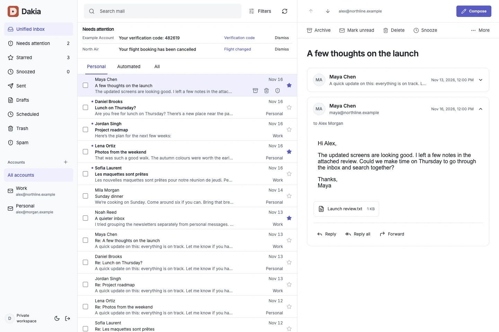
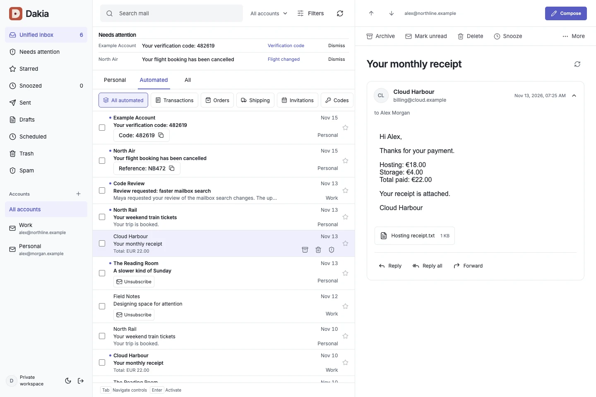
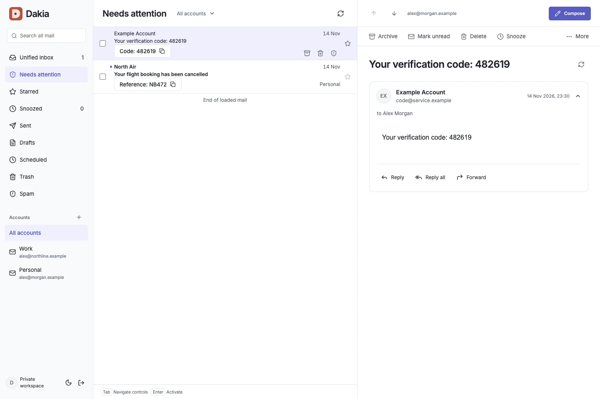
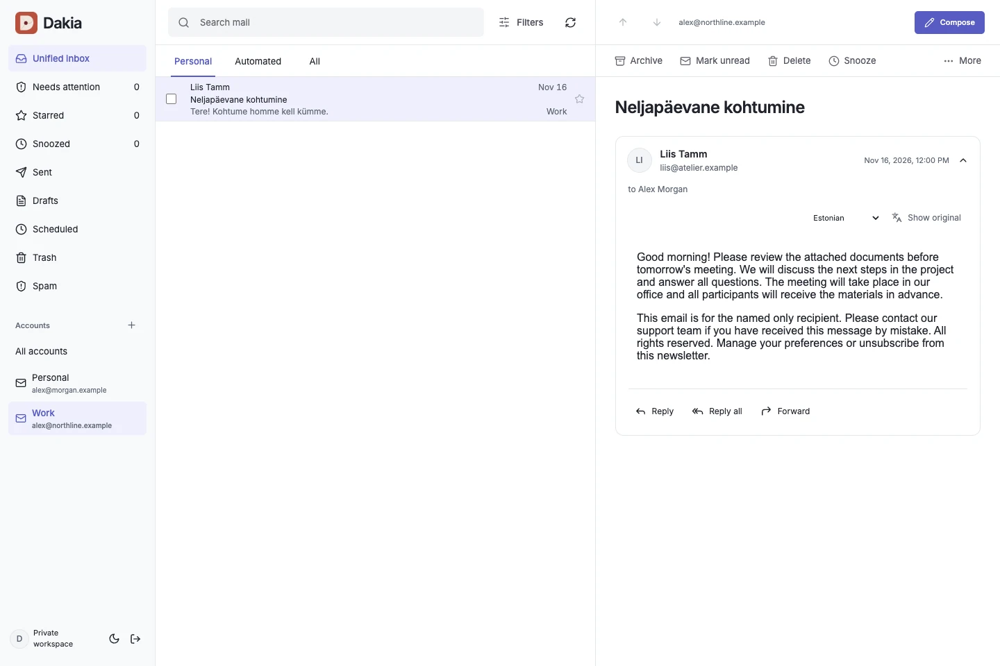
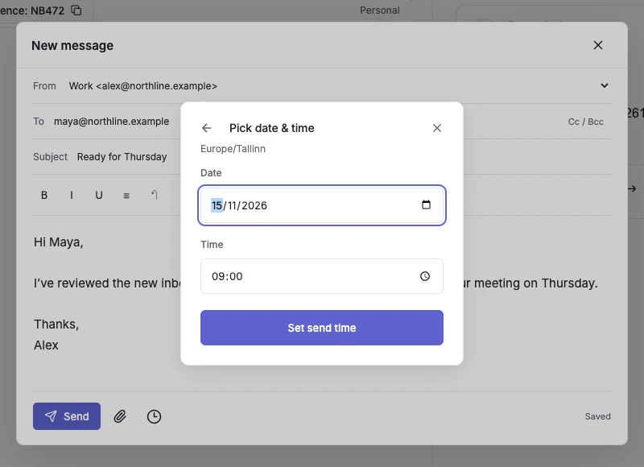
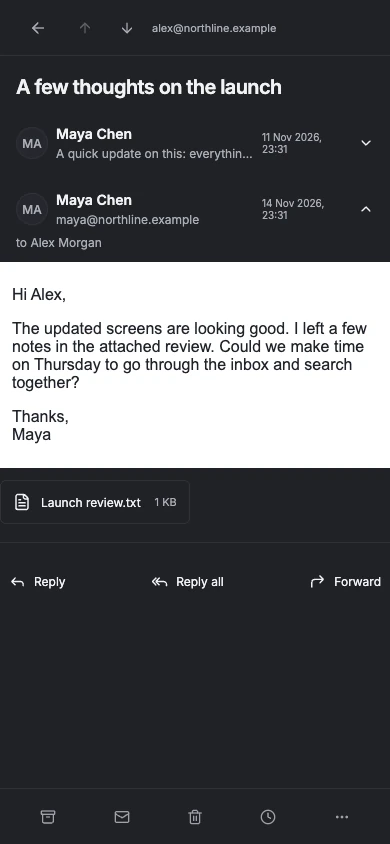

# Features

Dakia brings your existing mailboxes into one app. Connect Gmail with Google sign-in or an app password, Outlook.com and Microsoft 365 with Microsoft sign-in, or another provider through IMAP/SMTP. Start with [getting started](getting-started.md).

## Personal and Automated

The inbox starts with **Personal**. **Automated** keeps generated mail together, and **All** shows both. Dakia remembers your last inbox tab. Read messages stay in their tab, and uncertain mail stays in Personal.

Automated has filters for Transactions, Orders, Shipping, Invitations, Codes, Flights, Newsletters, Offers, and Security alerts. **Transactions** includes receipts and invoices. Types can overlap, so an order confirmation can also appear under Shipping when both are detected.

Use **More actions** in a message to correct Personal/Automated, remember or forget a sender preference for that mailbox, edit detected types, or change attention. An individual message correction takes priority over a sender preference. Classification runs on your server with local rules. Detection is best effort, especially outside English; see the [classification reference](personal-first-classification.md).

## Needs attention

Important items can surface above every inbox tab, including when they are Automated. **Needs attention** in the sidebar gives them a separate view. Examples include verification codes, flight changes, and payment problems. Where Dakia finds useful details, copy a code or open a labelled link directly from the list.

Reading doesn't dismiss attention. Dismiss it explicitly, snooze it, or archive it when finished. Attention covers mail received in the last 30 days. Code highlighting expires at a detected expiry or after 15 minutes when none is found; this doesn't determine whether the code itself is valid. Detection doesn't make payments or respond to invitations for you.

## Translation on your device

Choose **Translate to English** in a message and switch between the translation and original. On-device translation runs in your browser. Its first use downloads a language pack; saved packs can be reused after reloads and browser restarts, including offline when the message and session are already available.

The installation owner chooses **On devices**, **On devices with host fallback**, or **On the host** in **Workspace → Translation**. Server translation is the default. Everyone can remove saved language packs from their own browser. See [translation settings](on-device-translation.md) for supported behavior and storage limits.

## Search and conversations

Search across your connected accounts or narrow the scope to one mailbox. Follow replies in conversations, download attachments, star messages, and switch between folders. Recent folders and message bodies are saved in a bounded browser cache for faster reopening after session checks. See [saved mail and offline limits](persistent-local-cache.md).

## Write now, send later

Compose rich-text messages with attachments, reply, forward, and keep drafts. Choose a send time when a message should go later. Dakia must stay running and connected for scheduled sending.

## Clean up mail

Archive, move, mark read, snooze, or remove messages in bulk. Snooze hides a message from Inbox until your chosen time; **Snoozed** shows when it will return and lets you bring it back sooner.

Unsubscribe from supported mailing lists. To block an address, open a message and choose **More actions → Block sender**. Future mail from that address moves to Trash across your mailboxes without notifications during sync. Older mail stays where it is unless you review and confirm cleanup. Manage blocks in **Workspace → Blocked senders**. Unblocking doesn't restore Trash, and restored messages stay restored.

## Desktop and mobile

Use the responsive app in a browser or install it as a PWA. Sign in on another device with the same Dakia login. Keyboard shortcuts and optional hints support everyday mail actions; Tab reaches controls, and arrow keys navigate inbox tabs and menus. Shortcut preferences are in Workspace.

Workspace includes device notification status, enable/disable controls, and a local test alert. The test checks whether this device can display a notification; it does not verify server-to-device delivery. Disabling notifications removes this browser’s server subscription without changing other devices.

On supported browsers, **Workspace → Email links → Use Dakia for email links** offers browser registration. Installed apps also declare `mailto:` handling and a **Compose** shortcut. Email links prefill recipients, subject, and plain-text body in a draft; they never send automatically. Support and default-app selection depend on the browser and operating system.

Mobile browsers show a dismissible installation invitation after you have opened Dakia. The installation guide uses `@khmyznikov/pwa-install` for platform-specific steps. Dismissal pauses the invitation for 30 days on this browser, while Workspace always keeps installation available. Installing does not add offline sign-in or download a complete mailbox.

Optional push notifications require [host configuration](../workers/README.md) and browser permission. Personal mail and active attention items are eligible, subject to unread, block, and snooze rules. Notifications can display a message summary fetched by the signed-in browser; see [privacy](privacy.md).

## Separate logins and mailboxes

Invite others with single-use links. Each person gets separate mailbox connections, messages, search, drafts, and attachments. A unified inbox combines only that person's accounts. The owner's invitation controls don't give access to another person's mail through the app. The server operator still has access to host files and backups.

Workspace contains mailbox settings, reconnection, removal, image privacy, and translation settings. See [security](security.md) and [getting started](getting-started.md).

Screenshots use fictional mail. [Capture details](images/README.md).
